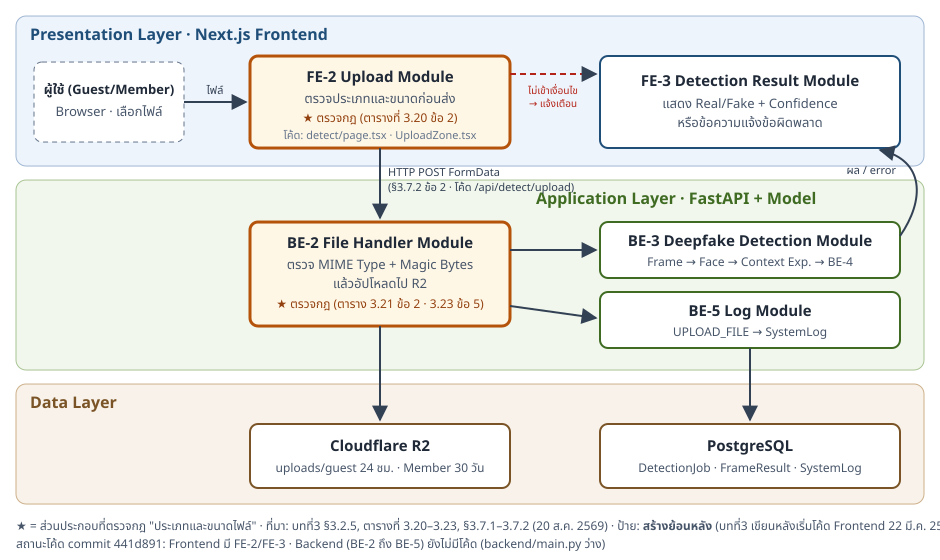

# ใบงานครั้งที่ 1 ส่วน B · วางแผนก่อนทดสอบ · DeepfakesDection

| รายการ | ข้อมูล |
|---|---|
| ชื่อทีม | DeepfakesDection (สมาชิก 1 คน) |
| ชื่อโครงงาน | เว็บแอปพลิเคชันตรวจจับ Deepfake อัจฉริยะเพื่อความมั่นคงปลอดภัยสารสนเทศ (กรณีศึกษา สำนักข่าว Lanner News) |
| เอกสารที่ใช้ | SRS `Software_Requirements_Specification.pdf` (IN-02) · Proposal SE02 Final 2 มี.ค. 2569 (IN-01) · บทที่3 การออกแบบ 20 ส.ค. 2569 (IN-03) |
| โค้ดที่อ้างถึง | repo ENGSE212 `MrTanapat/Deepfakes-Detections-Xceptionnet` commit `441d891` (26 พ.ค. 2569) |
| ป้ายของเอกสาร | SE02 และ SRS **มีก่อนพัฒนา** · บทที่3 **สร้างย้อนหลัง** เพราะเขียนหลังเริ่มโค้ด Frontend (commit แรก 22 มี.ค. 2569) |

## ขั้นที่ 1 feature และกฎที่สำคัญที่สุด

| หัวข้อ | คำตอบของทีม |
|---|---|
| feature | อัปโหลดไฟล์ภาพหรือวิดีโอเพื่อตรวจ Deepfake และตรวจไฟล์ก่อนประมวลผล (SE02 UC-02 อัปโหลดวิดีโอ · UC-03 ตรวจสอบความถูกต้องของไฟล์) |
| กฎที่สำคัญที่สุด | ระบบต้องรับเฉพาะไฟล์ประเภทที่รองรับ (JPG, PNG, MP4, MOV, AVI) ขนาดไม่เกิน 100 MB และไฟล์ที่ไม่ผ่านต้องถูกปฏิเสธพร้อมแจ้งเหตุผล **ก่อน** เข้าสู่การประมวลผล |
| พบกฎนี้ที่ไหน | SRS FR-002 "ตรวจสอบประเภทและขนาดไฟล์ก่อนประมวลผล" และข้อจำกัดด้านเทคโนโลยี ข้อ 1 · SE02 FR-03, NFR-01 (≤100 MB) · บทที่3 §3.7.1 ("เกิน 100 MB หรือประเภทไฟล์ไม่รองรับ ระบบจะแสดงข้อความแจ้งเตือน") |
| ทำไมเลือกข้อนี้ | เป็นทางเข้าเดียวของทุกการตรวจ ถ้าผิด ไฟล์ที่ใหญ่หรือเป็นอันตรายจะถูกส่งเข้า Backend และ R2 ทำให้ประมวลผลช้าเกินเกณฑ์ (SRS NFR-002) หรือเป็นช่องโหว่ (บทที่3 ST-03) และ บก. Lanner News ไม่รู้ว่าทำไมไฟล์ไม่ถูกตรวจ · เป็นส่วนเดียวของระบบที่มีโค้ดให้รันได้ในตอนนี้ |

## ขั้นที่ 2 ส่วนประกอบที่ feature นี้ผ่าน

**ที่มาของภาพ: สร้างย้อนหลัง** วาดจากบทที่3 §3.2.5 (3-Tier), ตารางที่ 3.20–3.23 และ §3.7.1–3.7.2 · บทที่3 เขียนเมื่อ 20 ส.ค. 2569 หลังเริ่มโค้ด Frontend · รหัส FE-x / BE-x ทีมตั้งตามลำดับในตารางที่ 3.20 และ 3.21

ภาพมีครบ 4 อย่าง: ชื่อส่วนประกอบ · ชั้นของแต่ละส่วน · ลูกศรทางเดินข้อมูล · ส่วนประกอบที่ตรวจกฎ (★ FE-2 และ BE-2)

## ขั้นที่ 3 สามคำถาม

| คำถาม | คำตอบและเหตุผล |
|---|---|
| 1 ใครรับผิดชอบ | ตามบทที่3 มีสองจุด คือ FE-2 Upload Module (ชั้น Presentation) ตรวจเบื้องต้นก่อนส่ง และ BE-2 File Handler Module (ชั้น Application) ตรวจ MIME Type และ Magic Bytes · จุดที่ถือเป็นทางการต้องเป็น BE-2 เพราะการเรียก API ตรงข้ามหน้าจอได้ · **แต่ในโค้ด commit `441d891` มีเพียง FE-2** ส่วน `backend/main.py` เป็นไฟล์ว่าง ตอนนี้กฎจึงถูกตรวจที่ชั้นหน้าจอชั้นเดียว |
| 2 ข้อมูลส่งถึงครบไหม | ไม่ครบ · บทที่3 §3.7.2 บอกเพียงว่า Frontend "ส่ง HTTP POST พร้อม FormData ไปยัง Backend API" ไม่ระบุ endpoint และไม่ระบุว่า BE-2 ตอบอะไรเมื่อไฟล์ไม่ผ่าน (สถานะ HTTP และข้อความ) จึงไม่รู้ว่า FE-3 ต้องแสดงอะไร · endpoint `/api/detect/upload` มีในโค้ด `detect.service.ts` เท่านั้น ไม่มีในเอกสาร |
| 3 ถ้าพัง จะรู้ได้ไหม | ถ้า FE-2 ปล่อยไฟล์เกินขนาดผ่าน ผู้ใช้จะเห็นปุ่ม START DETECTION ตามปกติและไม่รู้ว่าผิด จนกว่า Backend จะปฏิเสธหรือประมวลผลช้า · ต้องสังเกตที่ **ปลายทางผู้ใช้** (ข้อความบนหน้าจอและการมีหรือไม่มีปุ่มเริ่มตรวจ) ด้วย Unit test ของ FE-2 และ System test ผ่าน browser และเมื่อมี Backend ต้องสังเกต **ระหว่างส่วนประกอบ** ด้วย API test ของ BE-2 |

## ขั้นที่ 4 ข้อค้นพบ 1 ข้อ ครบ 4 ส่วน

| ส่วน | ข้อความ |
|---|---|
| 1 เอกสารเขียนว่าอะไร อยู่ตรงไหน | บทที่3 §3.7.1 เขียนว่าระบบตรวจ "ประเภทไฟล์ไม่รองรับ" และตารางที่ 3.20 ข้อ 2 ให้ Upload Module "ตรวจสอบประเภทและขนาดก่อนส่ง" แต่บทที่3 **ไม่มีรายการประเภทไฟล์ที่รองรับ** และไม่ระบุว่า 100 MB หมายถึง 100×1,000,000 หรือ 100×1,048,576 ไบต์ |
| 2 ขัดกับข้อใด | SRS ข้อจำกัดด้านเทคโนโลยี ข้อ 1 กำหนดว่า "รองรับเฉพาะ JPG, PNG และ MP4, MOV, AVI เท่านั้น" · ส่วน SE02 FR-02 พูดถึงเฉพาะไฟล์วิดีโอ และ SE02 §11.2.2 ระบุ .jpg .png .mp4 เท่านั้น พร้อมเงื่อนไขวิดีโอยาวไม่เกิน 30 วินาที ซึ่งบทที่3 FT-04 ใช้ 59 วินาที · เอกสารสามฉบับให้รายการไม่ตรงกัน และเอกสารออกแบบไม่ได้ยึดฉบับใด |
| 3 ผลต่อการทดสอบ | ทีมกำหนดผลที่คาดหวังของกรณี "ประเภทไฟล์" ได้จาก SRS เท่านั้น ถ้า SRS ไม่ใช่ฉบับที่ตกลงกัน ผลที่คาดหวังของ WEBP, AVI และภาพนิ่งอาจผิด · ค่าขอบของขนาดไฟล์ (100 MB ± 1 ไบต์) ตั้งได้ต่อเมื่อรู้ว่า 1 MB เท่ากับกี่ไบต์ |
| 4 ข้อเสนอ | ให้บทที่3 ระบุรายการ MIME type ที่รองรับและนิยาม 1 MB ไว้ในตารางที่ 3.20/3.21 ให้ตรงกับ SRS · บันทึกเป็นคำถาม DQ-01 (นิยาม MB) และ DQ-02 (รายการประเภทไฟล์) ใน W05 ผู้ตอบคือเจ้าของ requirement (ธนภัทร) ร่วมกับอาจารย์ที่ปรึกษา · ระหว่างรอ ทีมใช้ SRS และ 1 MB = 1,048,576 ไบต์เป็นสมมติฐาน และบอกไว้ในชุดกรณีทดสอบ |

ข้อเสนอไม่ได้เลือกรายการประเภทไฟล์แทนเจ้าของ requirement เพราะเป็นการตัดสินขอบเขตของระบบ

## ขั้นที่ 5 ขอบเขตและกลยุทธ์การทดสอบ

| หัวข้อ | คำตอบของทีม |
|---|---|
| ทดสอบ | ขนาดไฟล์ที่ขอบ 100 MB · ประเภทไฟล์ที่รองรับและไม่รองรับ · ข้อความแจ้งเหตุผลเมื่อไม่รับ · ไฟล์ที่ไม่ผ่านต้องส่งตรวจไม่ได้ · Guest เปิดหน้าตรวจและเลือกไฟล์ได้โดยไม่ต้องเข้าสู่ระบบ |
| ไม่ทดสอบ พร้อมเหตุผล | การตรวจ Magic Bytes และการอัปโหลดไป R2 ที่ BE-2 เพราะยังไม่มีโค้ด Backend (ออกแบบกรณีไว้ แต่บันทึกเป็น Not Executed) · ความแม่นยำของผล Real/Fake เพราะอยู่นอก feature นี้ (อยู่ใน W01 QR-01) |
| ระดับที่จะทดสอบ | Unit: ตรรกะตรวจไฟล์ใน FE-2 (`handleFile` ใน `detect/page.tsx`) · Integration (API): BE-2 รับไฟล์ปลอมนามสกุล (รอ Backend) · System: ผ่านหน้าจอ `/detect` แบบ Guest ใน browser · UAT: บก. Lanner News อัปโหลดคลิปข่าวจริงของตนเอง |
| ลำดับความเสี่ยง 3 อันดับ | 1 ไฟล์เกิน 100 MB ผ่านการตรวจและถูกส่งต่อ · 2 ไฟล์ที่รองรับถูกปฏิเสธ หรือไฟล์ที่ไม่รองรับผ่าน (รายการประเภทไม่ตรง SRS) · 3 ข้อความแจ้งไม่บอกเหตุผลหรือขนาดที่ถูกต้อง ทำให้ผู้ใช้ไม่รู้ว่าต้องแก้อะไร |

## ขั้นที่ 6 Entry 2 ข้อ และ Exit 2 ข้อ

| Entry | Exit |
|---|---|
| 1. มีไฟล์ทดสอบที่ทีมสร้างเอง ไม่มีใบหน้าบุคคลจริง ครบทุกค่าขอบของขนาด (100 MB − 1 ไบต์ · 100 MB · 100 MB + 1 ไบต์) และทุกประเภทในรายการที่รองรับและไม่รองรับ | 1. รันกรณีทดสอบของขนาดและประเภทไฟล์ครบทุกข้อในชุดอ้างอิง และทุกข้อมีไฟล์หลักฐานหรือสถานะ Not Executed พร้อมเหตุผล |
| 2. Frontend ที่ commit ระบุได้ รัน `next dev` ได้ และเปิด `/detect` แบบ Guest ได้โดยไม่ถูกส่งไปหน้าเข้าสู่ระบบ | 2. ทุกกรณีที่ไฟล์เกิน 100 MB หรือประเภทนอกรายการแต่ระบบยังรับ ถูกบันทึกเป็นข้อที่ไม่ผ่านพร้อมหลักฐาน และไม่มีข้อใดถูกปิดโดยไม่ได้รันซ้ำ |

ทุกข้อวัดได้ และเกี่ยวกับ feature อัปโหลดและตรวจไฟล์ ไม่ใช่เกณฑ์ทั่วไป

## ขั้นที่ 7 หน้าที่ของสมาชิกและการใช้ AI

ช่องรหัสนักศึกษา **เว้นไว้** เพราะ repo เป็น Public · ทีมมีสมาชิก 1 คน

| ชื่อ–สกุล | รหัส | ทำส่วนใด |
|---|---|---|
| ธนภัทร นุกูล (GitHub `MrTanapat`) | (เว้นไว้) | ขั้นที่ 1–7 ทั้งหมด · ตรวจทานข้อค้นพบ |

| ใช้ AI หรือไม่ เพื่ออะไร | ข้อเสนอที่รับ แก้ หรือปฏิเสธ | ตรวจกับโค้ดหรือเอกสารใด |
|---|---|---|
| ใช้ Claude อ่านเอกสารและโค้ด เสนอ feature กฎ และร่างใบงาน (ดู [AI-LOG.md](../AI-LOG.md)) | รับ feature อัปโหลดและตรวจไฟล์ · ไม่ให้ AI เลือกรายการประเภทไฟล์หรือนิยาม MB แทนเจ้าของ requirement (ตั้งเป็น DQ-01, DQ-02) | SRS ข้อจำกัดข้อ 1 · SE02 FR-02, FR-03, NFR-01, §11.2.2 · บทที่3 §3.7.1–3.7.2 ตารางที่ 3.20–3.23 · โค้ด `detect/page.tsx`, `detect.service.ts` commit `441d891` |
