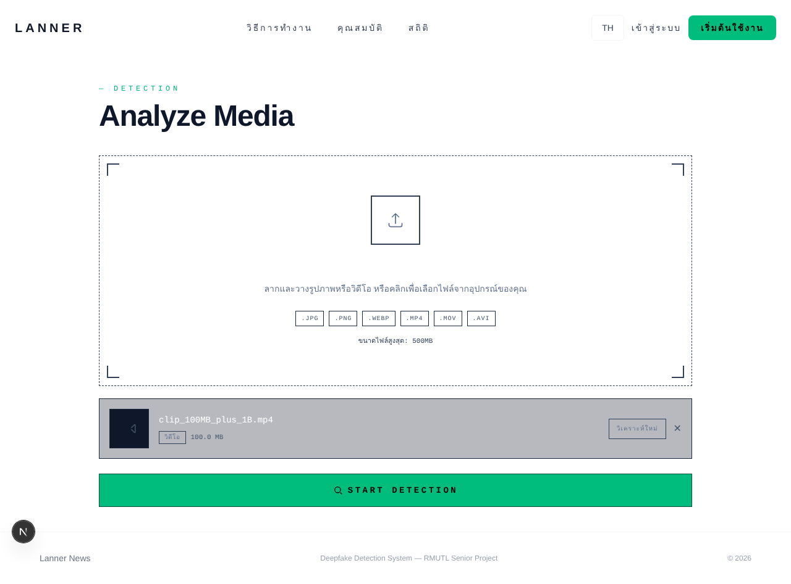

# ผลการรันจริง (B1) · DeepfakesDection_Team

| รายการ | ข้อมูล |
|---|---|
| ทีม · feature | DeepfakesDection_Team · อัปโหลดไฟล์และตรวจไฟล์ก่อนประมวลผล (UC-02 · UC-03) |
| รุ่นของระบบที่รัน | repo ENGSE212 [`MrTanapat/Deepfakes-Detections-Xceptionnet`](https://github.com/MrTanapat/Deepfakes-Detections-Xceptionnet) commit `441d891` (26 พ.ค. 2569) · Frontend Next.js 16.2.1 · **Backend ยังไม่มีโค้ด** (`backend/main.py` ว่าง) |
| ชุดอ้างอิงที่ใช้ | รุ่น v1 · [02-test-design/S2-B_DeepfakesDection_Team.md](../02-test-design/S2-B_DeepfakesDection_Team.md) · ไม่ได้แก้ |
| เครื่องมือ | Node.js 22.22.0 · Vitest 3.2.4 · jsdom 26.1.0 · @testing-library/react 16.3.0 · @playwright/test 1.56.1 กับ Chromium 141 (headless) |
| สภาพแวดล้อม | เครื่อง Linux x86_64 · Unit รันใน jsdom · System เปิด `next dev` ที่ `localhost:3000` แบบ Guest (ไม่เข้าสู่ระบบ) · ไฟล์ทดสอบสร้างด้วย [`make-test-data.sh`](tests/frontend/tests/e2e/make-test-data.sh) ไม่มีใบหน้าคนจริง · เครื่องทดสอบออกอินเทอร์เน็ตไม่ได้ ฟอนต์ Google Fonts จึงใช้ฟอนต์สำรอง |
| วันที่รัน · ผู้รัน | 22 ต.ค. 2569 เวลา 11:15 น. · รันโดย Claude (AI) ตามคำขอของ ธนภัทร นุกูล บนเครื่องทดสอบของ Claude (ดู [AI-LOG.md](../AI-LOG.md)) · ผลไม่ได้ถูกแก้ |

## ตรวจ Entry ของทีมก่อนรัน (จากใบงานครั้งที่ 1)

| Entry | เป็นจริงไหม | ทีมทำอย่างไร |
|---|---|---|
| มีไฟล์ทดสอบที่ทีมสร้างเอง ครบทุกค่าขอบของขนาด และทุกประเภทในรายการที่รองรับและไม่รองรับ | **ครบ** · ระดับ Unit กำหนดขนาดและ MIME ในโค้ดทดสอบ · ระดับ System ใช้ไฟล์จริง 5,242,880 และ 104,857,601 ไบต์ | สร้างด้วยสคริปต์ ไม่ commit ไฟล์ 100 MB ลง repo (เกิน 20 MB) |
| Frontend ที่ commit ระบุได้ รัน `next dev` ได้ และเปิด `/detect` แบบ Guest ได้ | **เป็นจริง** · `GET /detect` ตอบ 200 โดยไม่ถูกส่งไปหน้าเข้าสู่ระบบ | รันต่อได้ทุกข้อ ยกเว้น TC-12 ที่ต้องใช้ Backend |

## ขั้นที่ 1 เลือกระดับ

| TC | ระดับ | เหตุผล (พฤติกรรมอยู่ที่ไหน) |
|---|---|---|
| TC-01 | Unit | ตรรกะขนาดไฟล์อยู่ในฟังก์ชันเดียว `handleFile` ของ FE-2 (`detect/page.tsx`) ตรวจได้โดยไม่ต้องมีไฟล์จริงขนาด 100 MB |
| TC-02 | Unit | เหมือน TC-01 · ค่าขอบพอดี |
| TC-03 | Unit และ System (SYS-02) | Unit: ตรรกะอยู่ใน `handleFile` · System: ต้องดูด้วยว่าผู้ใช้เห็นอะไรเมื่อเลือกไฟล์จริงที่เลยขอบใน browser |
| TC-04 | Unit | ตรรกะอยู่ในฟังก์ชันเดียว |
| TC-05 | Unit | รายการประเภทไฟล์อยู่ในค่าคงที่ `ACCEPTED_TYPES` ที่ `handleFile` ใช้ |
| TC-06 | Unit | เหมือน TC-05 |
| TC-07 | Unit | เหมือน TC-05 |
| TC-08 | Unit | เหมือน TC-05 |
| TC-09 | Unit | เหมือน TC-05 · MIME ของ AVI ที่ browser ส่งมาขึ้นกับระบบปฏิบัติการ จึงกำหนดค่าเองในระดับ Unit |
| TC-10 | Unit | เหมือน TC-05 |
| TC-11 | Unit | เหมือน TC-05 |
| TC-12 | Integration (API) | การตรวจ Magic Bytes อยู่ที่ BE-2 File Handler Module ต้องเรียก API ตรงจึงจะเห็น · **Backend ยังไม่มีโค้ด** |
| SYS-01 | System | ต้องเห็นผลทั้งเส้นทางผ่านหน้าจอ: middleware (ไม่ถูกส่งไปหน้าเข้าสู่ระบบ) + UploadZone + `handleFile` |
| SYS-02 | System | ไฟล์ขนาดจริงผ่าน input ของ browser แล้วดูข้อความและปุ่มที่ผู้ใช้เห็น |

## ขั้นที่ 2 กรณีทดสอบอัตโนมัติ

| รายการ | ข้อมูล |
|---|---|
| TC และระดับ | TC-03 · Unit (รันทั้งไฟล์ จึงได้ผล TC-01 ถึง TC-11 ระดับ Unit ไปพร้อมกัน) |
| ไฟล์โค้ดทดสอบ | [tests/frontend/tests/unit/upload-validation.test.tsx](tests/frontend/tests/unit/upload-validation.test.tsx) · ตั้งค่า [vitest.config.mts](tests/frontend/vitest.config.mts) |
| คำสั่งที่ใช้รัน | `npx vitest run tests/unit/upload-validation.test.tsx` (ในโฟลเดอร์ `frontend` ของ repo โครงงาน) |
| หลักฐาน | [evidence/TC-01_to_TC-11_unit_2026-10-22.txt](evidence/TC-01_to_TC-11_unit_2026-10-22.txt) |
| สถานะ | **Fail** · ไฟล์ 100 MB + 1 ไบต์ ซึ่งต้องไม่รับ ระบบกลับรับและแสดงปุ่ม START DETECTION (Expected: null · Received: ปุ่ม START DETECTION) · รวมทั้งไฟล์: Pass 8 · Fail 3 (TC-03, TC-09, TC-10) |

ผลเทอร์มินัล ระดับ Unit (คัดลอกจากไฟล์หลักฐานทั้งก้อน ไม่ตัดไม่แก้)

```text
# วันที่รัน: 2026-10-22 11:15:11 +0700
# ระบบที่ทดสอบ: ENGSE212 Frontend (Next.js 16.2.1) · repo MrTanapat/Deepfakes-Detections-Xceptionnet commit 441d891
# Node.js v22.22.0 · Vitest 3.2.4 · jsdom 26.1.0 · @testing-library/react 16.3.0 · เครื่อง: Linux x86_64
# โฟลเดอร์ที่รัน: /home/claude/mrtanapat/deepfakes-detections-xceptionnet/frontend
# คำสั่ง: npx vitest run tests/unit/upload-validation.test.tsx


 RUN  v3.2.4 /home/claude/mrtanapat/deepfakes-detections-xceptionnet/frontend

 ❯ tests/unit/upload-validation.test.tsx (11 tests | 3 failed) 184ms
   ✓ REQ-01 ขนาดไฟล์ไม่เกิน 100 MB (แบ่งกลุ่ม + ค่าขอบ) > TC-01 วิดีโอ MP4 ขนาด 104857599 ไบต์ ควรรับ (ขอบใน 100 MB − 1 ไบต์) 66ms
   ✓ REQ-01 ขนาดไฟล์ไม่เกิน 100 MB (แบ่งกลุ่ม + ค่าขอบ) > TC-02 วิดีโอ MP4 ขนาด 104857600 ไบต์ ควรรับ (ขอบ 100 MB พอดี) 12ms
   ✓ REQ-01 ขนาดไฟล์ไม่เกิน 100 MB (แบ่งกลุ่ม + ค่าขอบ) > TC-04 วิดีโอ MP4 ขนาด 20971520 ไบต์ ควรรับ (ตัวแทนกลุ่มที่ถูกต้อง 20 MB) 12ms
   × REQ-01 ขนาดไฟล์ไม่เกิน 100 MB (แบ่งกลุ่ม + ค่าขอบ) > TC-03 วิดีโอ MP4 ขนาด 100 MB + 1 ไบต์ ควรไม่รับ แจ้งว่าเกิน 100 MB (เลยขอบ) 31ms
     → expected <span …(1)>…(1)</span> to be null
   ✓ REQ-02 ประเภทไฟล์ที่รองรับ JPG PNG MP4 MOV AVI (แบ่งกลุ่ม) > TC-05 photo.jpg (image/jpeg) ขนาด 5 MB ควรรับ 12ms
   ✓ REQ-02 ประเภทไฟล์ที่รองรับ JPG PNG MP4 MOV AVI (แบ่งกลุ่ม) > TC-06 photo.png (image/png) ขนาด 5 MB ควรรับ 9ms
   ✓ REQ-02 ประเภทไฟล์ที่รองรับ JPG PNG MP4 MOV AVI (แบ่งกลุ่ม) > TC-07 clip.mp4 (video/mp4) ขนาด 5 MB ควรรับ 8ms
   ✓ REQ-02 ประเภทไฟล์ที่รองรับ JPG PNG MP4 MOV AVI (แบ่งกลุ่ม) > TC-08 clip.mov (video/quicktime) ขนาด 5 MB ควรรับ 8ms
   × REQ-02 ประเภทไฟล์ที่รองรับ JPG PNG MP4 MOV AVI (แบ่งกลุ่ม) > TC-09 clip.avi (video/x-msvideo) ขนาด 5 MB ควรรับ 9ms
     → expected 'Unsupported file type.' to be '' // Object.is equality
   × REQ-02 ประเภทไฟล์ที่รองรับ JPG PNG MP4 MOV AVI (แบ่งกลุ่ม) > TC-10 photo.webp (image/webp) ขนาด 5 MB ควรไม่รับ และแจ้งว่าไม่รองรับ 9ms
     → expected <span …(1)>…(1)</span> to be null
   ✓ REQ-02 ประเภทไฟล์ที่รองรับ JPG PNG MP4 MOV AVI (แบ่งกลุ่ม) > TC-11 report.pdf (application/pdf) ขนาด 5 MB ควรไม่รับ และแจ้งว่าไม่รองรับ 6ms

⎯⎯⎯⎯⎯⎯⎯ Failed Tests 3 ⎯⎯⎯⎯⎯⎯⎯

 FAIL  tests/unit/upload-validation.test.tsx > REQ-01 ขนาดไฟล์ไม่เกิน 100 MB (แบ่งกลุ่ม + ค่าขอบ) > TC-03 วิดีโอ MP4 ขนาด 100 MB + 1 ไบต์ ควรไม่รับ แจ้งว่าเกิน 100 MB (เลยขอบ)
AssertionError: expected <span …(1)>…(1)</span> to be null

- Expected: 
null

+ Received: 
<span
  class="relative flex items-center justify-center gap-2"
>
  <svg
    class="h-4 w-4"
    fill="none"
    stroke="currentColor"
    stroke-width="2"
    viewBox="0 0 24 24"
  >
    <circle
      cx="11"
      cy="11"
      r="7"
    />
    <path
      d="M21 21l-3-3"
      stroke-linecap="round"
    />
  </svg>
  START DETECTION
</span>

 ❯ tests/unit/upload-validation.test.tsx:53:25
     51|   test("TC-03 วิดีโอ MP4 ขนาด 100 MB + 1 ไบต์ ควรไม่รับ แจ้งว่าเกิน 10…
     52|     const { startButton, errorText } = selectFile(makeFile("clip.mp4",…
     53|     expect(startButton).toBeNull();
       |                         ^
     54|     expect(errorText).toContain("100");
     55|   });

⎯⎯⎯⎯⎯⎯⎯⎯⎯⎯⎯⎯⎯⎯⎯⎯⎯⎯⎯⎯⎯⎯⎯⎯[1/3]⎯

 FAIL  tests/unit/upload-validation.test.tsx > REQ-02 ประเภทไฟล์ที่รองรับ JPG PNG MP4 MOV AVI (แบ่งกลุ่ม) > TC-09 clip.avi (video/x-msvideo) ขนาด 5 MB ควรรับ
AssertionError: expected 'Unsupported file type.' to be '' // Object.is equality

- Expected
+ Received

+ Unsupported file type.

 ❯ tests/unit/upload-validation.test.tsx:67:23
     65|   ])("%s %s (%s) ขนาด 5 MB ควรรับ", (_id, name, type) => {
     66|     const { startButton, errorText } = selectFile(makeFile(name, type,…
     67|     expect(errorText).toBe("");
       |                       ^
     68|     expect(startButton).not.toBeNull();
     69|   });

⎯⎯⎯⎯⎯⎯⎯⎯⎯⎯⎯⎯⎯⎯⎯⎯⎯⎯⎯⎯⎯⎯⎯⎯[2/3]⎯

 FAIL  tests/unit/upload-validation.test.tsx > REQ-02 ประเภทไฟล์ที่รองรับ JPG PNG MP4 MOV AVI (แบ่งกลุ่ม) > TC-10 photo.webp (image/webp) ขนาด 5 MB ควรไม่รับ และแจ้งว่าไม่รองรับ
AssertionError: expected <span …(1)>…(1)</span> to be null

- Expected: 
null

+ Received: 
<span
  class="relative flex items-center justify-center gap-2"
>
  <svg
    class="h-4 w-4"
    fill="none"
    stroke="currentColor"
    stroke-width="2"
    viewBox="0 0 24 24"
  >
    <circle
      cx="11"
      cy="11"
      r="7"
    />
    <path
      d="M21 21l-3-3"
      stroke-linecap="round"
    />
  </svg>
  START DETECTION
</span>

 ❯ tests/unit/upload-validation.test.tsx:76:25
     74|   ])("%s %s (%s) ขนาด 5 MB ควรไม่รับ และแจ้งว่าไม่รองรับ", (_id, name,…
     75|     const { startButton, errorText } = selectFile(makeFile(name, type,…
     76|     expect(startButton).toBeNull();
       |                         ^
     77|     expect(errorText).not.toBe("");
     78|   });

⎯⎯⎯⎯⎯⎯⎯⎯⎯⎯⎯⎯⎯⎯⎯⎯⎯⎯⎯⎯⎯⎯⎯⎯[3/3]⎯


 Test Files  1 failed (1)
      Tests  3 failed | 8 passed (11)
   Start at  11:15:11
   Duration  1.31s (transform 249ms, setup 0ms, collect 459ms, tests 184ms, environment 366ms, prepare 106ms)


# exit code: 1
```

## ขั้นที่ 3 System

| รายการ | ข้อมูล |
|---|---|
| TC | SYS-01 · REQ-04 และ SYS-02 · REQ-01/REQ-04 |
| ขั้นตอน | 1. เปิด `http://localhost:3000/detect` โดยไม่เข้าสู่ระบบ <br> 2. คลิกพื้นที่อัปโหลดแล้วเลือกไฟล์ (SYS-01 `clip_5MB.mp4` · SYS-02 `clip_100MB_plus_1B.mp4`) <br> 3. อ่านข้อความบนหน้าจอ และดูว่ามีปุ่ม START DETECTION หรือไม่ |
| ผลที่คาดหวัง | SYS-01: URL ยังเป็น `/detect` เห็นชื่อไฟล์และปุ่มเริ่มตรวจ · SYS-02: ไม่มีปุ่มเริ่มตรวจ เห็นข้อความบอกขีดจำกัด 100 MB (จากชุดอ้างอิง v1) |
| ผลจริง | SYS-01: อยู่ที่ `/detect` เห็น `clip_5MB.mp4` 5.0 MB และปุ่ม START DETECTION · ภาพ [ขั้น 1](evidence/SYS-01_system_2026-10-22_1-open.png) · [ขั้น 2](evidence/SYS-01_system_2026-10-22_2-selected.png) <br> SYS-02: ระบบรับไฟล์ แสดง `clip_100MB_plus_1B.mp4` **100.0 MB** และปุ่ม START DETECTION ไม่มีข้อความผิดพลาด · หน้าจอเขียนว่า "ขนาดไฟล์สูงสุด: 500MB" และแสดงป้าย .WEBP · ภาพ [หลังเลือกไฟล์](evidence/SYS-02_system_2026-10-22_1-after-select.png) |
| สถานะ | SYS-01 **Pass** · SYS-02 **Fail** (Expected 0 ปุ่ม · Received 1) · ผลอัตโนมัติ: [evidence/SYS-01_SYS-02_system-auto_2026-10-22.txt](evidence/SYS-01_SYS-02_system-auto_2026-10-22.txt) |



ขั้นตอนนี้กดผ่าน Chromium ด้วยสคริปต์ Playwright ([upload.spec.ts](tests/frontend/tests/e2e/upload.spec.ts)) เพื่อถ่ายภาพหน้าจอทีละขั้น · หน้าจอแสดง 100.0 MB เพราะปัดทศนิยม ผู้ใช้จึงแยกไม่ออกว่าไฟล์เกินขีดจำกัด 1 ไบต์

## ขั้นที่ 4 UAT

ผู้ทดสอบ UAT คือผู้ใช้จริงหรือตัวแทนผู้ใช้ ไม่ใช่สมาชิกทีม

| รายการ | ข้อมูล |
|---|---|
| ชื่อสถานการณ์ · ผู้ทดสอบ | UAT-01 ตรวจคลิปข่าวที่ได้รับจากแหล่งข่าวก่อนเผยแพร่ · ตัวแทนกองบรรณาธิการ Lanner News 1 คน |
| ขั้นตอน (ลำดับงานของผู้ใช้) | 1. เปิดเว็บโดยไม่สมัครสมาชิก <br> 2. เลือกคลิปข่าวที่ได้รับจริงบนเครื่องของตน <br> 3. ถ้าระบบไม่รับ อ่านข้อความแล้วบอกว่าต้องแก้อะไร <br> 4. เลือกไฟล์ใหม่จนเริ่มตรวจได้ |
| ถือว่าผ่านเมื่อ | ผู้ทดสอบทำเสร็จเองโดยไม่ถามทีม และอธิบายเหตุผลที่ไฟล์ไม่ถูกรับได้ถูกต้อง |
| สถานะ และแผน | **Not Executed** · ยังไม่ได้นัดผู้ทดสอบ และระบบรุ่น `441d891` ยังไม่มี Backend จึงเริ่มตรวจจริงไม่ได้ และยังมีข้อที่ไม่ผ่าน 4 ข้อในการตรวจไฟล์ · แผน: นัดตัวแทน บก. Lanner News 1 คน หลังแก้ TC-03, TC-09, TC-10, SYS-02 และมี Backend รับไฟล์ ผู้ประสานคือ ธนภัทร นุกูล · ไฟล์คลิปของผู้ทดสอบจะไม่ถูกเก็บใน repo |

## ขั้นที่ 5 ตารางผลของทุกกรณีทดสอบ

| TC | ระดับ | ผลที่คาดหวัง | ผลจริง | สถานะ | หลักฐาน |
|---|---|---|---|---|---|
| TC-01 | Unit | รับ 100 MB − 1 ไบต์ | รับ มีปุ่มเริ่มตรวจ | Pass | [unit](evidence/TC-01_to_TC-11_unit_2026-10-22.txt) |
| TC-02 | Unit | รับ 100 MB พอดี | รับ มีปุ่มเริ่มตรวจ | Pass | [unit](evidence/TC-01_to_TC-11_unit_2026-10-22.txt) |
| TC-03 | Unit · System | ไม่รับ 100 MB + 1 ไบต์ แจ้ง 100 MB | รับ มีปุ่มเริ่มตรวจ ไม่มีข้อความ (Expected null · Received ปุ่ม) | **Fail** | [unit](evidence/TC-01_to_TC-11_unit_2026-10-22.txt) · [ภาพ SYS-02](evidence/SYS-02_system_2026-10-22_1-after-select.png) |
| TC-04 | Unit | รับ 20 MB | รับ | Pass | [unit](evidence/TC-01_to_TC-11_unit_2026-10-22.txt) |
| TC-05 | Unit | รับ JPG | รับ | Pass | [unit](evidence/TC-01_to_TC-11_unit_2026-10-22.txt) |
| TC-06 | Unit | รับ PNG | รับ | Pass | [unit](evidence/TC-01_to_TC-11_unit_2026-10-22.txt) |
| TC-07 | Unit | รับ MP4 | รับ | Pass | [unit](evidence/TC-01_to_TC-11_unit_2026-10-22.txt) |
| TC-08 | Unit | รับ MOV | รับ | Pass | [unit](evidence/TC-01_to_TC-11_unit_2026-10-22.txt) |
| TC-09 | Unit | รับ AVI (`video/x-msvideo`) | ไม่รับ "Unsupported file type." | **Fail** | [unit](evidence/TC-01_to_TC-11_unit_2026-10-22.txt) |
| TC-10 | Unit | ไม่รับ WEBP แจ้งไม่รองรับ | รับ มีปุ่มเริ่มตรวจ | **Fail** | [unit](evidence/TC-01_to_TC-11_unit_2026-10-22.txt) |
| TC-11 | Unit | ไม่รับ PDF แจ้งไม่รองรับ | ไม่รับ "Unsupported file type." | Pass | [unit](evidence/TC-01_to_TC-11_unit_2026-10-22.txt) |
| TC-12 | API | 4xx ไม่เก็บไฟล์ปลอมนามสกุล | — | **Not Executed** | Backend ยังไม่มีโค้ด (`backend/main.py` ว่าง) · โค้ดทดสอบยังไม่ได้เขียนเพราะยังไม่มี endpoint ในเอกสารออกแบบ (W05 DQ) · แผน: เขียนและรันเมื่อมี BE-2 ผู้รับผิดชอบ ธนภัทร |
| SYS-01 | System | อยู่ `/detect` เห็นชื่อไฟล์และปุ่ม | อยู่ `/detect` เห็น `clip_5MB.mp4` และปุ่ม | Pass | [ภาพ 1](evidence/SYS-01_system_2026-10-22_1-open.png) · [ภาพ 2](evidence/SYS-01_system_2026-10-22_2-selected.png) · [auto](evidence/SYS-01_SYS-02_system-auto_2026-10-22.txt) |
| SYS-02 | System | ไม่มีปุ่ม เห็นข้อความ 100 MB | มีปุ่ม ไม่มีข้อความ หน้าจอบอก "ขนาดไฟล์สูงสุด: 500MB" | **Fail** | [ภาพ](evidence/SYS-02_system_2026-10-22_1-after-select.png) · [auto](evidence/SYS-01_SYS-02_system-auto_2026-10-22.txt) |

สรุป: Pass 9 · Fail 4 · Blocked 0 · Not Executed 1 · (UAT 1 สถานการณ์ Not Executed พร้อมแผน)

ทีมไม่ได้แก้ผลที่คาดหวังของ TC-03, TC-09, TC-10 และ SYS-02 ให้ตรงกับผลจริง · ไม่ต้องทำ B2 เพราะไม่ได้สอนครั้งที่ 4

## ไม่อยู่ในชุดนี้

| เรื่อง | เหตุผล |
|---|---|
| ไฟล์ 0 ไบต์ และวิดีโอยาวเกิน 30 วินาที | เอกสารไม่ได้กำหนดผลที่ต้องเป็น และ SE02 กับบทที่3 ขัดกันเรื่องความยาววิดีโอ (W05 DQ-03) |
| การอัปโหลดไป R2 และผล Real/Fake | Backend ยังไม่มีโค้ด และผลการตรวจจับอยู่นอก feature นี้ (W01 QR-01) |
